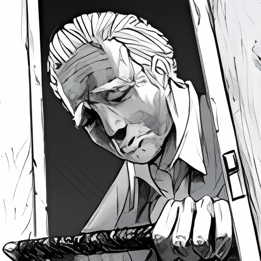

Minimal **onnx runtime** for running `fp32 precision` models on **x86_64** CPUs ⚡

Notes:

- Runtime is very constrained, only few type of models and certain runtime behaviors are supported (thanks to onnx spec
  for making this harder)
- Model parser is quite weak and complex to implement and needs to have a reasonably simple graph
- Nothing is assumed, anything "alien" to this runtime's scope is rejected and panics instead of silently ignoring or
  assuming, which may lead to bad undesired outputs
- Operators correctness tests are not covered yet, so expect some undesired behaviors/outputs on sophisticated operators
  used by the model

> The goal is that:
> "`If model passes the checks during loading, it should run without any silent errors or corrupted outputs`"

Benchmarks and correctness:

[ESRGAN](https://aihub.qualcomm.com/compute/models/esrgan) 69.80 MB

| Runtime | Time  | Input                                               | Output                                                        |
|---------|-------|-----------------------------------------------------|---------------------------------------------------------------|
| ONNX_RS | 4.61s |  |  |
| ORT     | 1.16s |  |      |

[Real-ERSRGAN-Anime](https://huggingface.co/deepghs/imgutils-models/blob/main/real_esrgan/RealESRGAN_x4plus_anime_6B.onnx)
17.21 MB

| Runtime | Time     | Input                                               | Output                                                                   |
|---------|----------|-----------------------------------------------------|--------------------------------------------------------------------------|
| ONNX_RS | 1.40s    |  |  |
| ORT     | 550.08ms |  |      |

[ClearReality-SPAN](https://huggingface.co/huggingworld/onnx-image-models/blob/main/4x-ClearRealityV1.onnx) 1.72 MB

| Runtime | Time     | Input                                               | Output                                                               |
|---------|----------|-----------------------------------------------------|----------------------------------------------------------------------|
| ONNX_RS | 220.54ms |  |  |
| ORT     | 71.60ms  |  |      |

[SRGAN](https://aihub.qualcomm.com/compute/models/srgan) 6.92 MB

| Runtime | Time     | Input                                               | Output                                                       |
|---------|----------|-----------------------------------------------------|--------------------------------------------------------------|
| ONNX_RS | 1.14s    |  |  |
| ORT     | 335.56ms |  |      |

[Upscayl-Standard](https://huggingface.co/huggingworld/onnx-image-models/blob/main/upscayl-standard-4x.onnx) 67.16 MB

| Runtime | Time  | Input                                               | Output                                                                  |
|---------|-------|-----------------------------------------------------|-------------------------------------------------------------------------|
| ONNX_RS | 4.55s |  |  |
| ORT     | 1.56s |  |      |

[Upscayl-High-Fidelity](https://huggingface.co/huggingworld/onnx-image-models/blob/main/upscayl-high-fidelity-4x.onnx)
67.16 MB

| Runtime | Time   | Input                                               | Output                                                                       |
|---------|--------|-----------------------------------------------------|------------------------------------------------------------------------------|
| ONNX_RS | 4.54ms |  |  |
| ORT     | 1.22ms |  |      |

---

More **models/kernels** will be supported in the future...